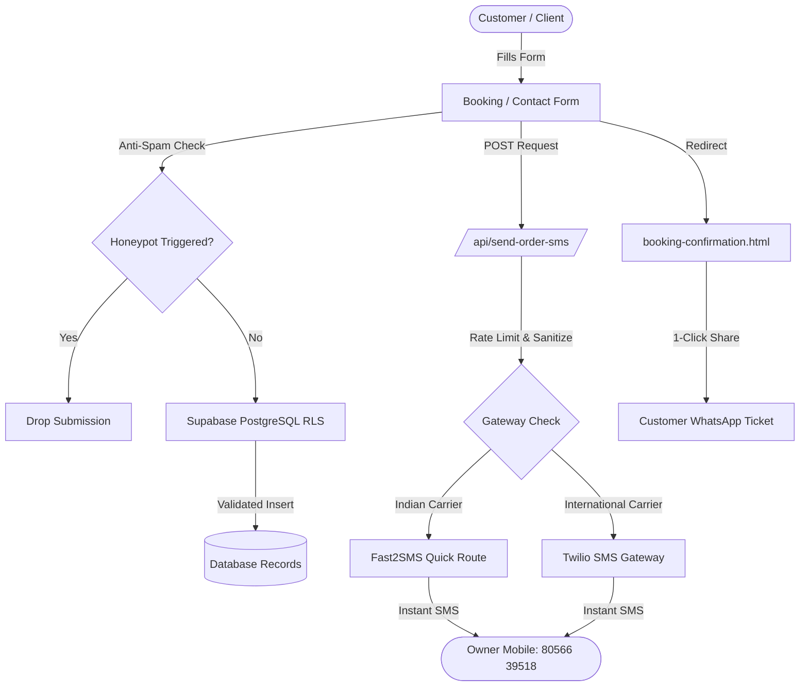

<div align="center">

# 💧 R-Tech Pure Water

**Enterprise-Grade RO Purification Platform & Booking System**

[](LICENSE)
[](SECURITY.md)
[](https://ro-water-rouge.vercel.app)
[](https://supabase.com)
[](https://wa.me/918056639518)

[🌐 View Live Website](https://ro-water-rouge.vercel.app) • [📖 Documentation](#-table-of-contents) • [🛡️ Security Policy](SECURITY.md) • [💬 Report Bug](.github/ISSUE_TEMPLATE/bug_report.md)

</div>

---

## 📋 Table of Contents
- [About R-Tech Pure Water](#-about-r-tech-pure-water)
- [Key Features](#-key-features)
- [Architecture & Data Flow](#-architecture--data-flow)
- [Security & Defensive Hardening](#-security--defensive-hardening)
- [Tech Stack](#-tech-stack)
- [Local Development](#-local-development)
- [Environment Variables](#-environment-variables)
- [Project Structure](#-project-structure)
- [Authors & Acknowledgments](#-authors--acknowledgments)
- [License](#-license)

---

## 🌟 About R-Tech Pure Water

**R-Tech Pure Water** is a production web application engineered for certified RO water purifier installations, multi-stage filter replacements, precision TDS testing, and emergency technician booking across Tirupathur, Tamil Nadu.

Equipped with a secure **Supabase Database** with Row-Level Security, **Vercel Serverless API** notifications, instant 1-click **WhatsApp Direct Integration**, and a dedicated customer confirmation dashboard.

---

## 🚀 Key Features

| Feature | Description |
| :--- | :--- |
| **Instant Multi-Channel Alerts** | Real-time dual dispatch to owner mobile (`+91 80566 39518`) and customer on service booking or contact inquiry. |
| **Floating Card Footer** | Modern elevated card layout featuring direct contact pills (`Phone`, `WhatsApp`, `Email`, `Maps`) and zero duplicate icons. |
| **Dedicated Confirmation Page** | Animated `#RTW-XXXXXX` digital receipt with 1-click WhatsApp slip sharing, technician calling, and print options. |
| **Interactive Owner Dashboard** | Protected owner portal with 1-click customer WhatsApp actions and customer profile lookups. |
| **Global Quick Contact Bar** | Floating 24/7 WhatsApp & Direct Phone Call widget on every page. |
| **Zero Vulnerabilities** | Automated npm dependency security scanning, strict input sanitization, and anti-spam honeypots. |

---

## 📐 Architecture & Data Flow



---

## 🛡️ Security & Defensive Hardening

Security is integrated by design across all components:

* **Strict Row-Level Security (RLS)** ([`supabase/schema.sql`](supabase/schema.sql)):
  * Public anonymous access is restricted to `INSERT` only.
  * `SELECT`, `UPDATE`, and `DELETE` queries strictly require authenticated owner access (`yoganathan541541@gmail.com`).
* **HTTP Security Headers** ([`vercel.json`](vercel.json)):
  * `X-Content-Type-Options: nosniff`
  * `X-Frame-Options: SAMEORIGIN`
  * `X-XSS-Protection: 1; mode=block`
  * `Referrer-Policy: strict-origin-when-cross-origin`
  * `Permissions-Policy: camera=(), microphone=(), geolocation=()`
  * `Strict-Transport-Security: max-age=63072000; includeSubDomains; preload`
* **API Rate Limiting & Input Sanitization** ([`api/send-order-sms.js`](api/send-order-sms.js)):
  * IP-based rate limiting (6 requests/minute) prevents endpoint flooding.
  * Strips HTML tags and normalizes multiline text to eliminate payload injection.
* **Anti-Bot Honeypots**:
  * Hidden non-tabbable honeypot fields on booking and contact forms silently neutralize automated web crawlers.
* **Zero Security Vulnerabilities**:
  * Validated clean through `npm audit` (0 vulnerabilities).

---

## 💻 Tech Stack

* **Frontend**: Semantic HTML5, CSS3 (Modern Flexbox & CSS Grid, Plus Jakarta Sans), Vanilla JavaScript (ES6+).
* **Icons**: [RemixIcon 4.6.0](https://remixicon.com/).
* **Database & Auth**: [Supabase](https://supabase.com) (PostgreSQL 15 with Row-Level Security).
* **Serverless Backend**: Vercel Serverless Functions (Node.js 20).
* **Communication Gateways**: Fast2SMS, Twilio, WhatsApp Click-to-Chat API.
* **Dev Server**: Built-in zero-dependency Node.js HTTP/API dev server ([`dev-server.js`](dev-server.js)).

---

## 💻 Local Development

### Prerequisites
* Node.js v18 or later
* Git

### Quick Start
```bash
# 1. Clone the repository
git clone https://github.com/01jackrichard/ro-water.git
cd ro-water

# 2. Install dependencies
npm install

# 3. Start the local development server
npm run dev
```

Server endpoints will be active:
* **Web Application:** `http://localhost:3000`
* **Owner Portal:** `http://localhost:3000/admin/login.html`
* **API Endpoint:** `http://localhost:3000/api/send-order-sms`

---

## ⚙️ Environment Variables

Copy [`.env.example`](.env.example) to `.env` to configure notification channels:

```env
# Official Owner Mobile Number (Default)
OWNER_PHONE_NUMBER=8056639518

# OPTION 1: Fast2SMS (India Quick Transactional Route)
FAST2SMS_API_KEY=your_fast2sms_api_key

# OPTION 2: Twilio SMS Gateway (International)
TWILIO_ACCOUNT_SID=your_twilio_sid
TWILIO_AUTH_TOKEN=your_twilio_auth_token
TWILIO_PHONE_NUMBER=+1234567890
```

---

## 📁 Project Structure

```
ro-water/
├── .github/
│   ├── ISSUE_TEMPLATE/
│   │   ├── bug_report.md
│   │   ├── feature_request.md
│   │   └── config.yml
│   ├── workflows/
│   │   └── ci.yml
│   ├── dependabot.yml
│   └── PULL_REQUEST_TEMPLATE.md
├── admin/
│   ├── css/
│   │   └── admin.css
│   ├── admin.js
│   ├── bookings.html
│   ├── customers.html
│   ├── dashboard.html
│   ├── login.html
│   └── messages.html
├── api/
│   └── send-order-sms.js       # Vercel Serverless SMS endpoint
├── css/
│   └── style.css               # Main styling & floating footer cards
├── js/
│   ├── booking.js              # Booking form & honeypot logic
│   ├── contact.js              # Contact form & WhatsApp integration
│   ├── layout.js               # Dynamic navbar, footer & quick contact
│   ├── script.js               # Counter animations & UI helpers
│   ├── supabase-app.js         # Supabase client initializer
│   └── supabase-config.js      # Public project credentials
├── supabase/
│   └── schema.sql              # Hardened PostgreSQL schema & RLS
├── about.html
├── booking.html
├── booking-confirmation.html   # Dedicated order receipt page
├── contact.html
├── dev-server.js               # Local dev server
├── index.html
├── owner-details.html
├── products.html
├── services.html
├── vercel.json                 # Security headers & clean URLs
├── CONTRIBUTING.md
├── CODE_OF_CONDUCT.md
├── LICENSE                     # MIT License
├── package.json
├── README.md
└── SECURITY.md                 # Vulnerability disclosure policy
```

---

## 👥 Authors & Acknowledgments

* **Original Creator & Owner:** [Yoganathan_A](https://github.com/yoganathan-sys) (`yoganathan541541@gmail.com`)
* **Core Contributor & Security Architect:** [Jack Richard](https://github.com/01jackrichard) (`01jackrichard@gmail.com`)

---

## 📄 License

This project is licensed under the **MIT License** — see the [LICENSE](LICENSE) file for complete details.
